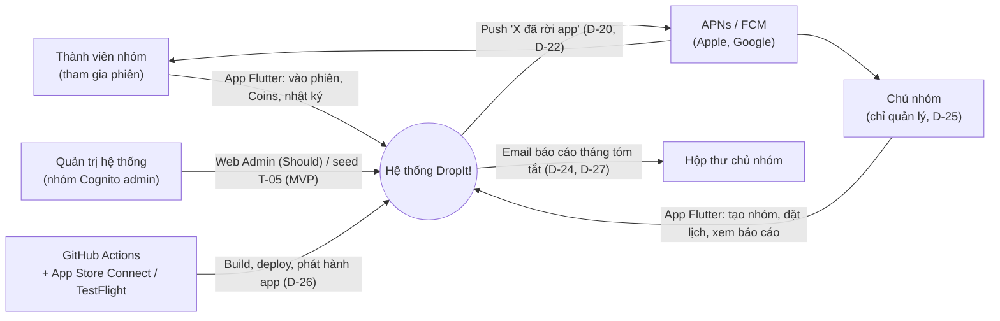
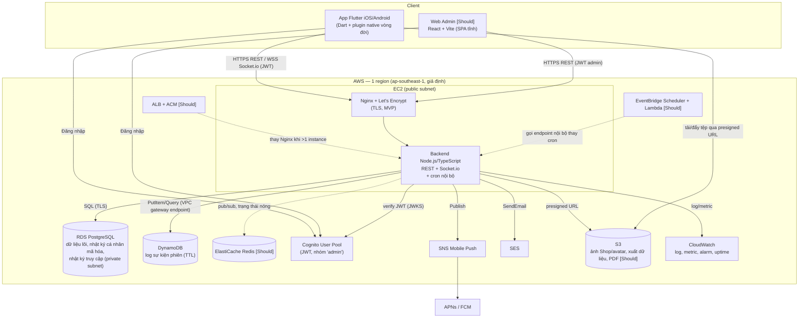
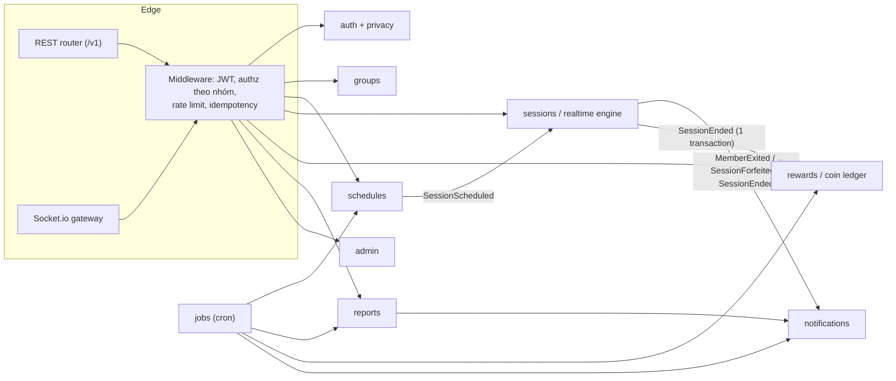
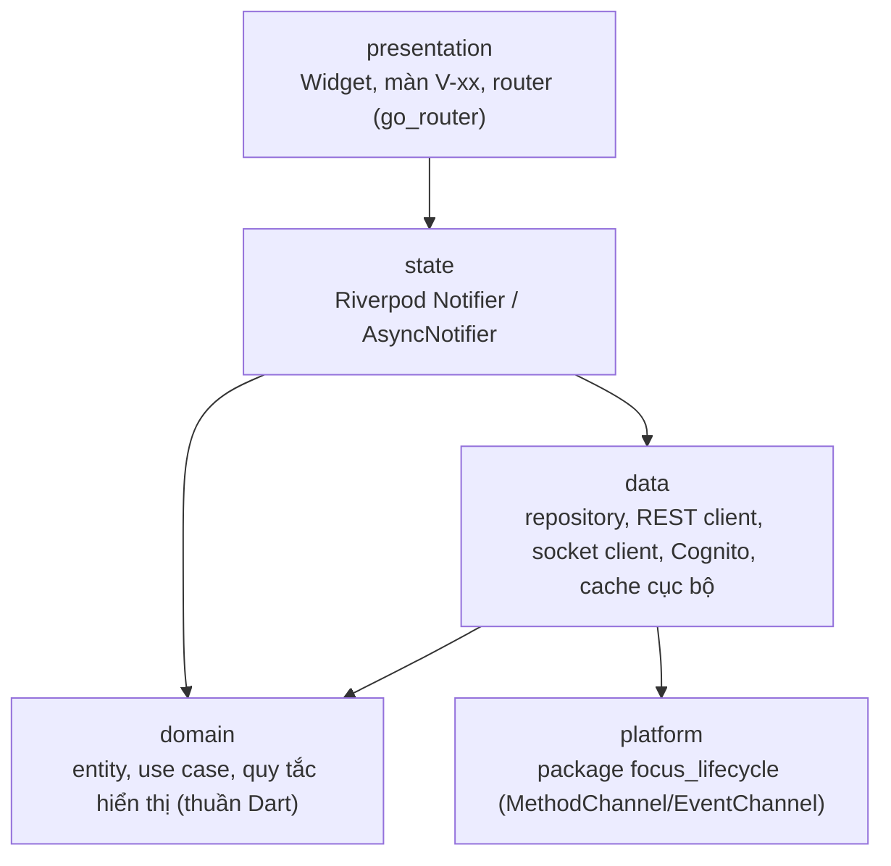
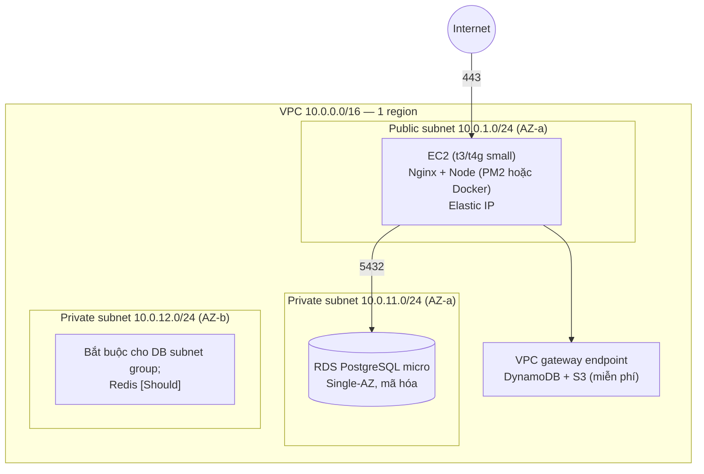

# Thiết kế 01 — Kiến trúc hệ thống DropIt!

Giai đoạn 3 — Thiết kế. Ngày tạo: 2026-10-19.
Nguồn: `ba/srs/00-SRS.md`, `ba/02-so-quyet-dinh.md` (D-01…D-29), `ba/srs/01-pham-vi.md`, `ba/srs/03-quy-tac.md`, `ba/srs/04-nfr-rieng-tu.md` (NFR + ánh xạ AWS), `ba/srs/05-tham-chieu-ky-thuat.md`, `ba/backlog.md`, `spike/t01-lifecycle/README.md`.

Quy ước: **(đề xuất)** = thiết kế chưa chốt, có mã `DQ-` (câu hỏi thiết kế) ở §7. Khi mâu thuẫn, D-xx và BR/NFR thắng tài liệu này. Must/Should theo bảng "Ánh xạ dịch vụ AWS" của `04-nfr-rieng-tu.md` (T-BA-78: story Must chỉ phụ thuộc dịch vụ Must).

---

## 1. Bối cảnh và container (C4)

### 1.1 C4 mức 1 — Bối cảnh



### 1.2 C4 mức 2 — Container

Nét liền = Must MVP. Nét đứt / khối ghi **[Should]** = không là điều kiện "xong" của story Must.



Ghi chú:
- App gọi Cognito trực tiếp để lấy token (thư viện chờ DQ-04); backend chỉ **xác minh** JWT, không giữ mật khẩu.
- 8 dịch vụ AWS Must (EC2, RDS, DynamoDB, Cognito, SNS, S3, CloudWatch, SES) vượt yêu cầu ≥ 3.

---

## 2. Kiến trúc backend

### 2.1 Kiểu kiến trúc

**Modular monolith** một tiến trình Node.js/TypeScript trên 1 EC2 (ADR-01). Module giao tiếp qua **service công khai** và **bus sự kiện trong tiến trình** (`EventEmitter` có kiểu). Không module nào truy vấn bảng của module khác trực tiếp.



### 2.2 Module và ranh giới

| Module | Trách nhiệm | Dữ liệu sở hữu | Nguồn |
| --- | --- | --- | --- |
| `auth` | Xác minh JWT Cognito (JWKS, cache), ánh xạ `cognito_sub → users.id`, hồ sơ, xóa tài khoản (BR-72), đăng ký endpoint push thiết bị | `users`, `device_tokens`, `idempotency_keys` | EP-01, NFR-10 |
| `privacy` (trong `auth`) | "Dữ liệu của tôi" (NFR-P03, NFR-P11), xuất (NFR-P12), nhật ký truy cập (NFR-P07), nhật ký cá nhân mã hóa (NFR-P05) | RDS `journals` (mã hóa phong bì KMS), `access_logs` (DQ-D04, DQ-D06) | EP-07, NFR-P |
| `groups` | Tạo nhóm (mục đích bắt buộc, NFR-P09), mã mời (BR-76), đồng ý có phiên bản (NFR-P04, NFR-P19), rời nhóm/rút đồng ý (D-23), tối đa 1 nhóm thành viên (D-21), chủ nhóm không là dòng thành viên (D-25), `max_groups_owned` | `groups`, `group_members`, `consents`, `group_invites`, `invite_attempts` | EP-02 |
| `schedules` | Lịch do chủ nhóm đặt (D-06), lặp (BR-113), nhắc trước (`reminder_min`, BR-79) | `schedules` | EP-03 |
| `sessions` (realtime engine) | Máy trạng thái phiên/thành viên, khoan hồng, tạm dừng, heartbeat, khóa màn hình (D-08), `forfeited` một lần (D-05), "Rời phiên" (D-29, BR-118), mất mạng → LOST (D-19), sự cố server (BR-22, BR-68), một socket/(người, phiên) (BR-70) | `sessions`, `session_members`, `session_pauses`; log sự kiện → DynamoDB `dropit-session-events` | EP-03, BR-03…39, BR-63…70 |
| `rewards` | Sổ cái Coins chỉ-thêm (BR-44), trần ngày giờ VN (D-09, NFR-21), chuỗi (D-11, D-12, D-23), huy hiệu, Shop | `coin_ledger`, `users.current_streak/longest_streak` + `achievement_log` (không bảng `streaks`, DQ-D05), `daily_attendance`, `badges`, `user_badges`, `shop_items`, `user_items`, `user_equipped` | EP-05, EP-06 |
| `notifications` | Chọn kênh: socket cho người đang mở app; SNS push cho người không có trạng thái chưa kết thúc trong phiên (BR-27, NFR-01/02); thử lại `push_retry` (BR-81); email SES | `notifications` (hộp thông báo + trạng thái push), `device_tokens` | EP-04, D-20, D-22 |
| `reports` | Báo cáo tháng bản chụp (BR-56), thử lại (BR-101), chi tiết phiên cho chủ nhóm (US-08.10, D-28: chỉ kéo để làm mới), PDF [Should] lên S3 | `monthly_reports`, `monthly_report_rows`, `explanations`, `appeals` | EP-08, D-24 |
| `admin` | API cho Web Admin [Should]: tham số cấu hình (bảng tham số `03-quy-tac.md`), khiếu nại, `admin_audit`. MVP: seed T-05 | `system_params`, `admin_audit`, `abuse_reports` | EP-09, T-05 |
| `jobs` | Lập lịch định kỳ (§2.4); chỉ gọi service của module khác | `job_runs` | US-08.01 |

Ranh giới quan trọng:
- `sessions` **không** gọi SNS/SES trực tiếp; phát sự kiện miền, `notifications` quyết định kênh.
- `rewards` chỉ ghi Coins khi nhận `SessionEnded` kèm trạng thái cuối bất biến (BR-32). Chốt phiên + Coins + chuỗi trong **một transaction PostgreSQL** (D-05; `05-tham-chieu-ky-thuat.md` §3.1).
- Mọi truy vấn dữ liệu người khác đi qua lớp `authz` (§5.2); chủ nhóm/quản trị xem dữ liệu thành viên → ghi `access_logs` (NFR-P07).

### 2.3 Nguồn sự thật

| Dữ liệu | Nguồn sự thật | Ghi chú |
| --- | --- | --- |
| Thời gian phiên, mọi mốc (`started_at`, `ends_at`, hạn khoan hồng, `forfeited_at`) | **Đồng hồ server** (BR-03, BR-33) | `clientTs` chỉ để log/đo trễ. Client hiển thị `remaining` theo độ lệch đồng hồ đo bằng ping (như spike). |
| Trạng thái phiên đang chạy | Bộ nhớ tiến trình (MVP, 1 instance); Redis khi > 1 instance [Should] | Chuyển trạng thái quan trọng ghi kèm RDS (`session_members.state`) để xác định CANCELLED/VOID sau sự cố (BR-22, BR-68). |
| Trạng thái cuối, Coins, chuỗi | RDS PostgreSQL | Bất biến sau khi chốt; sửa chỉ qua bút toán bù (miễn trừ, NFR-P14). |
| Danh tính | Cognito | `users.cognito_sub` là khóa nối. |
| Vai trò chủ nhóm/thành viên | RDS (`groups.owner_id`, `group_members`) | D-10; không dùng Cognito group cho vai trò theo nhóm. |
| Log sự kiện phiên | DynamoDB (chỉ-thêm, TTL) | Phục vụ chi tiết phiên, giải trình, khiếu nại; không là nguồn tính Coins. |
| Tham số cấu hình (`grace_s`, `coins_25`…) | RDS `system_params`, cache trong tiến trình | Áp dụng khi nào: DQ-13. |

### 2.4 Job định kỳ (MVP: cron trong tiến trình trên EC2)

`node-cron` (hoặc tương đương) trong chính tiến trình backend, múi giờ `Asia/Ho_Chi_Minh` (NFR-21). Mỗi job lấy khóa tư vấn PostgreSQL (`pg_try_advisory_lock`) để không chạy trùng nếu sau này > 1 instance, và ghi `job_runs` để chạy bù khi khởi động lại.

| Job | Lịch | Việc | Nguồn |
| --- | --- | --- | --- |
| `open-scheduled-sessions` | Mỗi 30 giây (đề xuất, DQ-03) | Nạp phiên từ lịch sắp tới: mở phòng chờ `lobby_open_min` trước, đặt hẹn COUNTDOWN tại `started_at − countdown_s`. Mốc chính xác do bộ hẹn giờ trong engine (theo giờ server); cron chỉ "nạp". | D-06, BR-01, BR-04, BR-63 |
| `send-reminders` | Mỗi phút | Push nhắc trước `reminder_min` | BR-79 |
| `close-day` | 00:05 hằng ngày | Chốt chuỗi ngày trước; trần Coins ngày tính theo ngày VN | D-09, NFR-21 |
| `monthly-report` | 02:00 ngày 1 | Tạo báo cáo bản chụp mỗi nhóm; thử lại đến `report_retry_max` / `report_retry_deadline` 06:00 | BR-56, BR-101, NFR-17 |
| `send-report-email` | Ngay sau mỗi báo cáo tạo xong | SES gửi tóm tắt, không đính kèm, không tracking pixel/link theo dõi | D-24, D-27, NFR-17 (≤ 1 giờ) |
| `retention-purge` | 03:00 hằng ngày | Xóa tài khoản quá `account_purge_days`, dữ liệu RDS quá `retention_months` (gồm `access_logs` quá `access_log_retention_months`, `idempotency_keys` hết hạn); DynamoDB và S3 tự xóa bằng TTL/Lifecycle | BR-72, BR-73, BR-103 |

Rủi ro: EC2 khởi động lại đúng 02:00 → `job_runs` cho chạy bù lúc khởi động (trước 06:00). Phương án Should: EventBridge Scheduler → Lambda → endpoint nội bộ có ký; logic không đổi.

### 2.5 Engine phiên (tóm tắt)

- Mỗi phiên đang chạy là một `SessionRuntime` trong bộ nhớ, có **hàng đợi lệnh tuần tự**: mọi sự kiện của một phiên xử lý lần lượt → không tranh chấp, `forfeited` đặt đúng một lần (K-09).
- Sự kiện C→S/S→C theo `05-tham-chieu-ky-thuat.md` §2; mỗi sự kiện có `event_id`, bỏ trùng (BR-31).
- Bộ hẹn giờ: hạn khoan hồng (`grace_s`), tạm dừng (`pause_max_min`), `heartbeat_timeout_s`, `disconnect_hold_s`, hết giờ phiên.
- Khởi động lại tiến trình: phiên chưa kết thúc trong RDS → CANCELLED; thành viên chưa kết thúc VOID, người đã EXITED giữ EXITED (BR-22, BR-68, NFR-15).
- Điểm nghiệp vụ còn `Chờ` được thiết kế thành cờ cấu hình, mặc định theo BR hiện hành, không tự chốt: Q-149 (Rời phiên khi WAITING), Q-151 (`LOCK_RECLASSIFY`), Q-152 (swipe-kill), Q-153 (mất mạng khi WAITING).

### 2.6 Cấu trúc thư mục backend (đề xuất)

```
backend/
  src/
    app.ts                 # khởi tạo HTTP + Socket.io + cron
    config/                # env, tham số, logger (JSON → CloudWatch)
    shared/                # db, dynamo, errors, authz, idempotency, clock
    modules/
      auth/ groups/ schedules/ sessions/ rewards/
      notifications/ reports/ admin/ jobs/
        <module>/{routes.ts, socket.ts, service.ts, repo.ts, events.ts, *.test.ts}
  migrations/              # SQL migration (DQ-09)
  test/                    # tích hợp, kịch bản K-01…K-15
```

---

## 3. Kiến trúc app Flutter

### 3.1 Phân lớp



- `presentation` không gọi mạng; chỉ đọc provider.
- `domain` thuần Dart, test đơn vị không cần thiết bị.
- `data` là nơi duy nhất biết REST, Socket.io, Cognito, plugin native.

### 3.2 Quản lý trạng thái: chọn Riverpod (đề xuất, DQ-01)

Lý do chọn Riverpod thay Bloc:
- Ít mã khuôn hơn; nhóm 5 người, Sprint 4 đã vượt năng lực (D-17).
- `StreamProvider`/`AsyncNotifier` hợp tự nhiên với luồng socket và luồng sự kiện vòng đời.
- Phụ thuộc giữa provider (token → client → repository) khai báo rõ, override dễ khi test, không cần `BuildContext`.
- Thế mạnh của Bloc (luồng sự kiện → trạng thái có kiểm soát) ít cần vì máy trạng thái quyết định nằm ở **server**; client chỉ phản chiếu.

Quy ước: `sessionControllerProvider(sessionId)` là Notifier duy nhất của màn phiên; nhận `session:state`, `session:countdown`, `member:grace`, `member:state`, `MEMBER_EXITED` (đã gộp `SESSION_FORFEITED` trong trường `forfeited`), `SESSION_CANCELLED*`, `SESSION_RESULT`… và gửi lệnh lên socket. Tên sự kiện theo `03-api-socket.md` §3.

### 3.3 Plugin native vòng đời (từ spike T-01)

Đóng gói mã spike thành package nội bộ `packages/focus_lifecycle`:

| Nền tảng | Tín hiệu | Phân loại |
| --- | --- | --- |
| Android | `ProcessLifecycleOwner` ON_START/ON_STOP + `PowerManager.isInteractive` + `KeyguardManager.isKeyguardLocked`; `ACTION_SCREEN_OFF/ON`, `ACTION_USER_PRESENT` đăng ký **động** chỉ khi đang ghi phiên | ON_STOP + màn tắt/khóa → LOCK; còn lại → LEAVE |
| iOS | `UIScene` willDeactivate/didEnterBackground/willEnterForeground/didActivate; `protectedDataWillBecomeUnavailable/DidBecomeAvailable`; `isProtectedDataAvailable` | didEnterBackground + dữ liệu bảo vệ không khả dụng → LOCK; `willResignActive` đơn thuần không tính |
| Chung (Dart) | `AppLifecycleListener` | Chờ `lockWaitMs` (600 ms, chờ số đo spike) xem có tín hiệu khóa; không có → `member:left_app`; `resumed` → `member:returned`; `detached` → gửi ngay (cố gắng) |

Ràng buộc: chỉ bật listener/receiver khi phiên đang ghi (NFR-P02); không `UsageStatsManager`, không quyền Usage Access, không cảm biến (BR-34, NFR-P01). Giới hạn iOS: tín hiệu khóa chỉ đúng khi máy có đặt mã khóa. Android Foreground Service: chờ spike trên ≥ 2 hãng (DQ-10). Log vòng đời từ xa cho iOS (R-K01) chỉ bật trên bản thử nội bộ.

### 3.4 Offline và nối lại

| Tình huống | Hành vi client | Căn cứ |
| --- | --- | --- |
| Mất mạng ngắn trong phiên | Socket.io tự nối lại (backoff ngắn), gửi `session:resume`; sự kiện vòng đời phát sinh khi mất mạng xếp hàng kèm `event_id`, gửi lại khi có mạng — **trừ** `session:leave` (không xếp hàng, D-29) | BR-20, BR-31, BR-118; server quyết định theo giờ server |
| Mất mạng ≥ `heartbeat_timeout_s + disconnect_hold_s` | Hiện "mất kết nối"; khi nối lại nhận trạng thái LOST | D-19, NFR-23 |
| Khóa màn hình | Gửi `member:screen_locked`; heartbeat theo BR-66 | D-08 |
| Server sự cố | Hiện hủy phiên ≤ 15 s | BR-22, NFR-15 |
| Ngoài phiên | Cache chỉ-đọc (nhóm, lịch, số dư Coins, báo cáo đã tải) (DQ-08). Thao tác ghi (đặt lịch, mua Shop, nhật ký) **không** xếp hàng offline ở MVP — báo lỗi, cho thử lại | Tránh xung đột sổ cái Coins |

Token: refresh token Cognito trong `flutter_secure_storage` (Keychain/Keystore); làm mới access token trước khi hết hạn; socket gửi lại token mới (NFR-10).

### 3.5 Cấu trúc thư mục app (đề xuất)

```
mobile/
  lib/
    main.dart
    app/            # router, theme (màn phiên tối — NFR-08), l10n vi
    core/           # env, http client, socket client, auth/token, clock offset, errors
    features/
      auth/ groups/ schedules/ session/ rewards/ shop/
      profile_journal/ reports/ notifications/ privacy/
        <feature>/{presentation/, state/, domain/, data/}
  packages/
    focus_lifecycle/   # plugin native từ spike T-01 (android/, ios/, lib/)
  test/  integration_test/
```

---

## 4. Triển khai AWS

### 4.1 Mạng



- Không NAT Gateway (tốn theo giờ). EC2 ở public subnet gọi Cognito/SNS/SES/CloudWatch trực tiếp; DynamoDB và S3 qua gateway endpoint.
- RDS `PubliclyAccessible = false`. Quản trị DB: SSM Session Manager port-forward qua EC2; không mở 5432 ra ngoài.

### 4.2 Security Group

| SG | Vào | Ra |
| --- | --- | --- |
| `sg-app` (EC2) | 443/tcp từ 0.0.0.0/0; 80/tcp chỉ để chuyển hướng HTTPS và gia hạn Let's Encrypt (NFR-09); **không** mở 22 (dùng SSM Session Manager) | 443 ra Internet; 5432 tới `sg-db` |
| `sg-db` (RDS) | 5432 chỉ từ `sg-app` (NFR-13) | — |
| `sg-cache` [Should] | 6379 chỉ từ `sg-app` | — |
| `sg-alb` [Should] | 443 từ 0.0.0.0/0; khi dùng, `sg-app` chỉ nhận từ `sg-alb` | tới `sg-app` |

### 4.3 Môi trường

| Môi trường | Hạ tầng | Dùng cho |
| --- | --- | --- |
| `dev` | Máy cá nhân: Docker Compose (PostgreSQL, DynamoDB Local, mock SNS/SES); Cognito User Pool dev dùng chung | Phát triển, test tự động |
| `staging` | (đề xuất, DQ-06) Cùng tài khoản AWS, tag `env=staging`: EC2 nhỏ, DB riêng trên instance RDS dùng chung với prod (hoặc RDS riêng tắt ngoài giờ), bảng DynamoDB/bucket S3 hậu tố `-staging`, User Pool riêng | Tích hợp, thử tải K-15, TestFlight nội bộ |
| `prod` | EC2 + RDS + tài nguyên `-prod` | Demo cuối |

Hạ tầng dạng mã (DQ-07) để dựng lại được và kiểm được NFR-13, NFR-22.

### 4.4 CI/CD GitHub Actions

| Workflow | Kích hoạt | Các bước |
| --- | --- | --- |
| `backend-ci` | PR, push | lint, typecheck, unit + integration (service container PostgreSQL, DynamoDB Local), gitleaks (NFR-13) |
| `backend-deploy` | merge `main` → staging; tag `v*` + phê duyệt Environment → prod | Build artifact → OIDC assume IAM role (không lưu access key) → đẩy lên S3 → SSM Run Command trên EC2: kéo bản mới, chạy migration, `pm2 reload`. Khởi động lại = CANCELLED phiên đang chạy (BR-22) → chặn deploy khi có phiên (DQ-14) |
| `mobile-android` | PR (debug), tag (release) | `flutter analyze/test` → build APK (và AAB) ký bằng keystore từ Secrets → artifact |
| `mobile-ios` | merge `main` hoặc `workflow_dispatch` | Runner macOS: `flutter build ipa` → ký bằng chứng chỉ/provisioning từ Secrets (keychain tạm) → upload TestFlight bằng App Store Connect API key (D-26, NFR-24). Không bước nào cần Mac vật lý. Chạy hạn chế để tiết kiệm phút macOS |
| `web-admin` [Should] | merge `main` | `vite build` → triển khai tệp tĩnh (DQ-11) |

### 4.5 Bí mật

| Bí mật | Nơi lưu |
| --- | --- |
| Chứng chỉ iOS (.p12), provisioning profile, App Store Connect API key, Android keystore | **GitHub Secrets** theo Environment (NFR-24) |
| Quyền deploy AWS | GitHub OIDC → IAM role quyền tối thiểu |
| Mật khẩu RDS, khóa APNs (.p8)/FCM cho SNS, khóa mã hóa nhật ký | SSM Parameter Store SecureString ở MVP; Secrets Manager là Could (DQ-05). EC2 đọc qua instance role |
| Cấu hình không bí mật (URL, ID User Pool) | Biến môi trường |

### 4.6 Giám sát và ngân sách

- CloudWatch: log ứng dụng dạng JSON (không chứa nội dung nhật ký hay dữ liệu nhạy cảm); metric tùy chỉnh: số socket, độ trễ `EXITED → push publish` và `EXITED → socket emit` (NFR-01, NFR-02), lỗi 5xx, CPU (NFR-05). Alarm → email nhóm. Kiểm tra `/health` từ ngoài trong giờ hành chính (NFR-14).
- **AWS Budgets** từ ngày đầu: cảnh báo 50% / 80% / 100% hạn mức nhóm (NFR-22). GitHub: spending limit cho phút macOS.
- Sao lưu RDS tự động; diễn tập khôi phục 1 lần trước demo (NFR-16).

---

## 5. Bảo mật và quyền riêng tư

### 5.1 Xác thực

- Cognito User Pool; access token hết hạn ≤ 60 phút (NFR-10). Backend xác minh chữ ký (JWKS), `iss`, `client_id`, `token_use = access`, `exp`.
- Socket.io: token trong handshake; kiểm lại khi client gửi token mới; token hết hạn → ngắt.
- Chỉ một Cognito group `admin` (D-10); route `/v1/admin/*` yêu cầu claim `cognito:groups` chứa `admin`.

### 5.2 Phân quyền theo nhóm ở server (NFR-11)

- Mọi route/sự kiện khai báo chính sách: `member(groupId)`, `owner(groupId)`, `self(userId)`, `participant(sessionId)`, `admin`. Middleware `authz` tra `group_members`/`groups.owner_id` trong RDS (cache ngắn, xóa khi đổi thành viên).
- Thiếu quyền → 403; không lộ tồn tại tài nguyên nhóm khác. Bộ test IDOR chạy trong CI (K-14).
- Lọc trường theo ma trận "ai thấy gì" (`04-nfr-rieng-tu.md` §3) bằng **DTO theo vai trò**: chủ nhóm không nhận chuỗi (D-12); thông báo thoát chỉ có tên, "đã rời app", thời điểm (NFR-P18, D-22); không có endpoint xếp hạng (NFR-P06, BR-115).

### 5.3 Không đọc dữ liệu ngoài phiên

- App: plugin vòng đời chỉ đăng ký khi đang ghi phiên; chỉ báo "Phiên đang được ghi" hiện đúng lúc đó (NFR-P08). Không xin quyền vị trí, danh bạ, Usage Access (NFR-P01). CI rà `AndroidManifest.xml`/`Info.plist` theo danh sách quyền cho phép.
- Server: từ chối và không lưu sự kiện vòng đời khi người gửi không có phiên đang ghi (NFR-P02).
- Payload sự kiện chỉ có `event_id`, `session_id`, loại sự kiện, `client_ts`, `reason_code` chọn sẵn (03-api-socket §3.2) — không có trường tự do về app khác (K-13).

### 5.4 Mã hóa

- Truyền: TLS ≥ 1.2 cho REST/WSS; kết nối RDS bắt buộc SSL (NFR-09).
- Lưu: RDS, DynamoDB, S3 bật mã hóa (NFR-12).
- Nhật ký cá nhân: mã hóa **phía server** ở tầng ứng dụng (AES-256-GCM, mã hóa phong bì, khóa chờ DQ-12) trước khi ghi bảng `journals` trên RDS (02-du-lieu §3, DQ-D06). Câu chữ trung thực theo NFR-P05. Không API nào trả nội dung nhật ký cho chủ nhóm/quản trị.
- S3: chặn truy cập công khai; tệp xuất/PDF qua presigned URL ngắn hạn; Lifecycle xóa theo thời hạn lưu.

### 5.5 Lưu giữ

- DynamoDB TTL, S3 Lifecycle, job `retention-purge` cho RDS theo `retention_months`, `account_purge_days`, `access_log_retention_months` (BR-72, BR-73, BR-103).

---

## 6. Quyết định kiến trúc (ADR)

Trạng thái: **Đề xuất** = chờ nhóm duyệt; **Theo D-/BR-** = hệ quả trực tiếp của quyết định/quy tắc đã chốt.

### ADR-01 — Modular monolith Node.js/TypeScript trên 1 EC2
- **Bối cảnh:** 5 người, 4 sprint; socket giữ trạng thái và bộ hẹn giờ khoan hồng 3 s ở server; NFR-05 chỉ 1.000 kết nối.
- **Quyết định:** Một tiến trình gồm REST + Socket.io + cron, chia module theo §2.2; trạng thái phiên trong bộ nhớ.
- **Hệ quả:** Đơn giản, rẻ, dễ debug. Khởi động lại = hủy phiên đang chạy (BR-22) → deploy tránh giờ phiên. Mở rộng ngang cần Redis adapter + ALB sticky (Should). Trạng thái: Đề xuất.

### ADR-02 — Server là nguồn sự thật về thời gian và trạng thái
- **Bối cảnh:** BR-03, BR-33; chống gian lận.
- **Quyết định:** Mọi mốc theo giờ server; client chỉ báo tín hiệu; xử lý tuần tự theo phiên, idempotent theo `event_id`.
- **Hệ quả:** Kết quả nhất quán giữa các máy; client cần đo lệch đồng hồ để hiển thị; độ trễ mạng ảnh hưởng khoan hồng thực tế (đo bằng spike). Trạng thái: Theo BR-03.

### ADR-03 — PostgreSQL cho lõi, DynamoDB cho log
- **Bối cảnh:** D-04; Coins cả phiên cần giao dịch (D-05).
- **Quyết định:** RDS cho dữ liệu quan hệ + sổ cái chỉ-thêm + nhật ký cá nhân (mã hóa) + nhật ký truy cập; DynamoDB chỉ cho log sự kiện phiên có TTL (`dropit-session-events`) và bảng kết nối socket [Should]. Lệch gợi ý 05 §3.3 ghi ở DQ-D04, DQ-D06.
- **Hệ quả:** Ghi DynamoDB nằm ngoài transaction RDS → ghi log bất đồng bộ có thử lại; mất log không ảnh hưởng Coins. Trạng thái: Theo D-04.

### ADR-04 — Cron trong tiến trình cho MVP
- **Bối cảnh:** T-BA-78; EventBridge + Lambda là Should.
- **Quyết định:** `node-cron` + khóa tư vấn PostgreSQL + `job_runs` chạy bù.
- **Hệ quả:** Không thêm dịch vụ; job phụ thuộc uptime EC2; chuyển sang EventBridge chỉ đổi nơi kích hoạt. Trạng thái: Theo bảng ánh xạ AWS.

### ADR-05 — Cognito chỉ cho danh tính; vai trò theo nhóm ở RDS
- **Bối cảnh:** D-10, D-25.
- **Quyết định:** Một Cognito group `admin`; chủ nhóm/thành viên tra RDS mỗi request.
- **Hệ quả:** Đổi vai trò không cần cấp lại token; thêm một truy vấn authz (giảm bằng cache ngắn). Trạng thái: Theo D-10.

### ADR-06 — Thông báo hai kênh: socket và SNS push
- **Bối cảnh:** D-20, D-22, BR-27, NFR-01, NFR-02.
- **Quyết định:** `notifications` tính tập người nhận: đang mở app → socket; không có trạng thái chưa kết thúc trong phiên và không mở app → SNS (APNs/FCM).
- **Hệ quả:** Cần theo dõi hiện diện "đang mở app" theo socket; đo độ trễ cả hai đường. Trạng thái: Theo D-20.

### ADR-07 — Flutter + Riverpod, plugin vòng đời native riêng
- **Bối cảnh:** D-07, D-08; Flutter không tự phân biệt khóa màn hình với rời app.
- **Quyết định:** Riverpod (§3.2); package `focus_lifecycle` từ spike T-01.
- **Hệ quả:** Phải duy trì mã native 2 nền tảng; iOS chỉ thử qua TestFlight (R-K01). Trạng thái: Đề xuất (DQ-01).

### ADR-08 — Build iOS trên GitHub Actions macOS
- **Bối cảnh:** D-26, NFR-24.
- **Quyết định:** Workflow `mobile-ios` ký và đẩy TestFlight; chạy khi merge `main`/thủ công.
- **Hệ quả:** Vòng phản hồi iOS chậm (build + xử lý TestFlight 5–30 phút); tốn phút macOS → cache, hạn chế kích hoạt. Trạng thái: Theo D-26.

### ADR-09 — TLS bằng Nginx + Let's Encrypt, không ALB/NAT ở MVP
- **Bối cảnh:** ALB/NAT tốn theo giờ; NFR-09; T-02 chỉ dùng dịch vụ Must.
- **Quyết định:** Nginx kết thúc TLS trên EC2 có Elastic IP.
- **Hệ quả:** Cần tên miền (DQ-02); một điểm hỏng duy nhất, chấp nhận theo NFR-14 (không Multi-AZ). Trạng thái: Đề xuất.

### ADR-10 — Web Admin là SPA tĩnh; MVP dùng seed
- **Bối cảnh:** EP-09 Should; T-05 seed thay giao diện admin.
- **Quyết định:** React + Vite build tĩnh, gọi `/v1/admin/*`; MVP không phụ thuộc nó.
- **Hệ quả:** Không có máy chủ riêng cho admin; nơi host chờ DQ-11. Trạng thái: Theo backlog.

---

## 7. Câu hỏi thiết kế mở (DQ-)

Không chốt ở đây; ghi lại để nhóm quyết. Không câu nào được trái D-01…D-29.

| Mã | Câu hỏi | Đề xuất | Liên quan | Trạng thái |
| --- | --- | --- | --- | --- |
| DQ-01 | Quản lý trạng thái Flutter: Riverpod hay Bloc? | Riverpod | ADR-07, §3.2 | Chờ |
| DQ-02 | Tên miền cho API/WSS (Let's Encrypt cần tên miền): mua tên miền riêng hay dùng DNS miễn phí? (Route 53 là Could) | Tên miền rẻ + DNS nhà đăng ký | ADR-09, NFR-09 | Chờ |
| DQ-03 | Mở phiên theo lịch: cron 30 s nạp phiên + bộ hẹn giờ chính xác trong engine, hay chỉ cron mỗi phút? | Cron 30 s + bộ hẹn giờ (sai số < 1 s) | §2.4, BR-04, BR-63 | Chờ |
| DQ-04 | Thư viện Cognito trên Flutter: Amplify Auth hay `amazon_cognito_identity_dart_2`? | Amplify Auth; kiểm kích thước app | §1.2, NFR-10 | Chờ |
| DQ-05 | Bí mật server: SSM Parameter Store SecureString hay Secrets Manager? | Parameter Store ở MVP | §4.5, NFR-13 | Chờ |
| DQ-06 | Staging: dùng chung instance RDS với prod (DB riêng) hay RDS riêng? Có cần staging trên AWS từ đầu? | Chung instance, DB riêng; dựng staging từ Sprint 3 khi thử tải | §4.3, NFR-22 | Chờ |
| DQ-07 | Hạ tầng dạng mã: Terraform hay AWS CDK (TypeScript)? | CDK TypeScript (cùng ngôn ngữ backend) | §4.3 | Chờ |
| DQ-08 | Cache cục bộ app: `drift` (SQLite) hay `hive`? Có xếp hàng thao tác ghi offline không? | `drift`; không xếp hàng ghi ở MVP | §3.4 | Chờ |
| DQ-09 | Truy cập DB backend: Prisma, Drizzle hay Kysely + SQL migration? | Drizzle hoặc Kysely (transaction rõ, gần SQL) | §2.6, ADR-03 | Chờ |
| DQ-10 | Android có dùng Foreground Service trong phiên (chống hãng giết tiến trình)? | Chờ kết quả spike T-01 trên ≥ 2 hãng | §3.3, NFR-19, BR-05 | Chờ |
| DQ-11 | Host Web Admin [Should]: Nginx trên EC2 phục vụ tệp tĩnh hay S3 + CloudFront (Could)? | Nginx trên EC2 (không thêm dịch vụ) | ADR-10 | Chờ |
| DQ-12 | Khóa mã hóa nhật ký: KMS customer managed key hay khóa lưu ở Parameter Store? | KMS CMK, IAM chỉ cho role EC2 (giảm R-P10) | §5.4, NFR-P05 | Chờ |
| DQ-13 | Đổi tham số cấu hình khi phiên đang chạy: áp dụng ngay hay chỉ phiên mở sau đó? | Chỉ phiên mở sau đó (chụp tham số lúc mở phiên) | §2.3, bảng tham số `03-quy-tac.md` | Chờ |
| DQ-14 | Chặn deploy prod khi có phiên đang chạy: cổng kiểm tra tự động trong CI hay chỉ quy ước khung giờ? | Bước CI gọi endpoint nội bộ đếm phiên đang chạy; > 0 thì dừng | ADR-01, BR-22, NFR-15 | Chờ |

Câu hỏi nghiệp vụ còn `Chờ` ảnh hưởng thiết kế (theo dõi ở `ba/02-so-quyet-dinh.md`, không phải DQ): Q-141, Q-142, Q-149, Q-150, Q-151, Q-152, Q-153.
