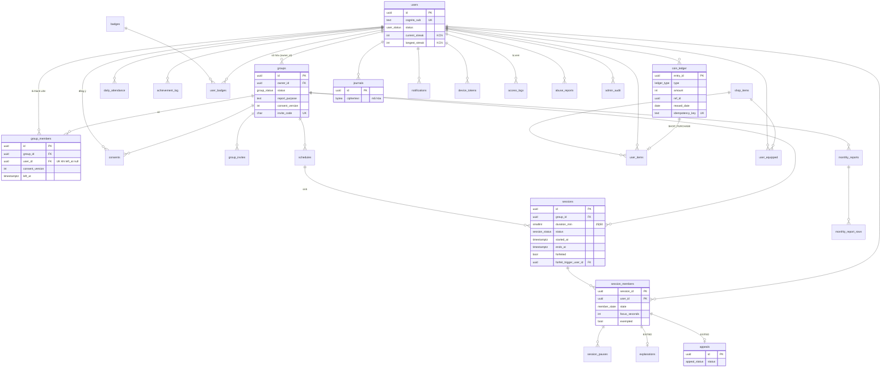

# DropIt! — Thiết kế dữ liệu (GĐ3)

Phiên bản 0.1 · 2026-10-19 · DDL: `design/schema.sql` (PostgreSQL 16).

Nguồn: `ba/02-so-quyet-dinh.md` (D-04, D-05, D-09, D-10, D-12, D-19…D-25), `ba/srs/03-quy-tac.md` (BR, máy trạng thái, tham số), `ba/srs/04-nfr-rieng-tu.md` (§3 ai thấy gì, §4 thời hạn lưu, NFR-12), `ba/srs/05-tham-chieu-ky-thuat.md` §3 (gợi ý ban đầu), `ba/srs/02-ep0*.md`, `spike/t01-lifecycle/server/server.js`.

> **Trạng thái kiểm thử DDL: chưa chạy.** Máy có `docker.exe` nhưng Docker daemon không chạy; không có `psql`/PostgreSQL cục bộ. Cách thử: `docker run -d --name pg -e POSTGRES_PASSWORD=x -p 5432:5432 postgres:16` rồi `psql -h localhost -U postgres -v ON_ERROR_STOP=1 -f design/schema.sql`.

## 1. Nguyên tắc

| # | Nguyên tắc | Nguồn |
| --- | --- | --- |
| P1 | PostgreSQL (RDS) giữ dữ liệu lõi có ràng buộc; DynamoDB giữ log sự kiện chi tiết có TTL. | D-04 |
| P2 | Trạng thái phiên đang chạy giữ trong bộ nhớ server (MVP 1 EC2), chốt xuống PostgreSQL trong **một transaction** ở các mốc: ACTIVE, EXITED/forfeited, `ends_at`, CANCELLED. | 05 §3.1 |
| P3 | Thời gian lưu `timestamptz` (UTC). "Ngày" nghiệp vụ (`session_day`, `reward_date`, `day`) là `date` theo Asia/Ho_Chi_Minh, do ứng dụng tính và **ghi sẵn**. | §Thưởng, BR-112 |
| P4 | Bảng chỉ-thêm (`coin_ledger`, `achievement_log`, `consents`, `admin_audit`, `access_logs`) có trigger chặn UPDATE/DELETE; chỉ job xóa theo hạn lưu được xóa (cờ `dropit.purge`). | BR-44, BR-73, BR-92 |
| P5 | **Coins và chuỗi không bao giờ trả cho chủ nhóm.** API chủ nhóm đọc qua `owner_session_member_view` (không có cột Coins/chuỗi) và lọc theo `group_id` mình sở hữu. | BR-53, D-12, Q-23 |
| P6 | Không có bảng nào lưu nội dung điện thoại, app đang dùng, vị trí. Sự kiện chỉ là trạng thái vòng đời app. | GĐ1 §6, D-03 |

Ký hiệu nhạy cảm dùng trong tài liệu: 🔒 = mã hóa nội dung ở tầng ứng dụng; **[KCN]** = không trả cho chủ nhóm; **[RT]** = có thời hạn lưu riêng.

## 2. ERD

DynamoDB (ngoài ERD quan hệ): `dropit-session-events`, `dropit-ws-connections` — xem §4.

## 3. Bảng PostgreSQL

Cột kiểu `uuid` mặc định `gen_random_uuid()`. Mọi bảng có `created_at`; bảng sửa được có `updated_at` (trigger).

### 3.1 `system_params` — tham số cấu hình (BR-112)
| Cột | Kiểu | Ràng buộc |
| --- | --- | --- |
| key | text | PK |
| value | jsonb | NOT NULL |
| configurable | bool | false = cố định (`duration_min`, `group_min/max_members`, `day_timezone`) |
| min_value / max_value | numeric | miền hợp lệ (BR-112) |
| updated_by | uuid | FK users |

Nạp sẵn mọi tham số trong §Phiên 5, §Thưởng 3, §Báo cáo 4, §Quản trị (mặc định đúng bảng). Mọi đổi tham số ghi `admin_audit`.

### 3.2 `users` (EP-01, EP-05, EP-07)
| Cột | Kiểu | Ràng buộc / ghi chú |
| --- | --- | --- |
| id | uuid | PK |
| cognito_sub | text | UNIQUE; NULL sau khi xóa |
| email | citext | UNIQUE; chỉ quản trị thấy |
| display_name | text | 2–30 ký tự sau trim, không ký tự điều khiển (BR-97) |
| avatar_key | text | khóa S3, đã cắt vuông/xóa EXIF (BR-98) |
| status | `user_status` ACTIVE/LOCKED/DELETED | CHECK `LOCKED ⇔ locked_at` |
| show_streak | bool | mặc định false (BR-99) |
| current_streak, longest_streak | int | ≥0, longest ≥ current. **[KCN]** (D-12, BR-53). Tái lập được từ `achievement_log` (BR-92) |
| streak_last_inc_day | date | chặn +1 hai lần/ngày (BR-49) |

Không có cột số dư Coins (suy từ sổ cái, BR-44) và không có "điểm uy tín". Vai trò quản trị lấy từ nhóm Cognito `admin`, không lưu ở đây.

### 3.3 `groups` (EP-02)
| Cột | Kiểu | Ràng buộc |
| --- | --- | --- |
| owner_id | uuid | FK users; trigger: ≤ `max_groups_owned` nhóm chưa giải tán (BR-75b) |
| name | text | 1–60 ký tự (giả định) |
| report_purpose | text | NOT NULL — mục đích báo cáo hiện ở màn đồng ý (NFR-P09) |
| retention_months | smallint | 1–13 |
| consent_version | int | ≥1; tăng khi đổi mục đích/thời hạn lưu/điều khoản (BR-71) |
| invite_code | char(8) | regex bỏ ký tự dễ nhầm; UNIQUE trong nhóm chưa giải tán (BR-76) |
| status | `group_status` ACTIVE / SCHEDULE_SUSPENDED / DISSOLVING / DISSOLVED | = HOẠT ĐỘNG / TẠM NGƯNG LỊCH / CHỜ GIẢI TÁN / ĐÃ GIẢI TÁN (T-BA-37). CHECK `DISSOLVED ⇔ dissolved_at` |
| suspended_at | timestamptz | mốc tính `lock_dissolve_days` (BR-108) |

Chỉ mục: `groups_owner_idx`. Trigger `groups_owner_not_member` chặn đổi chủ nhóm thành người đang là thành viên.

### 3.4 `group_members` (BR-71, BR-74, BR-75, BR-77; D-21, D-25)
| Cột | Kiểu | Ràng buộc |
| --- | --- | --- |
| group_id, user_id | uuid | FK |
| consent_version | int | phiên bản đã đồng ý; `< groups.consent_version` ⇒ vẫn là thành viên nhưng không vào phiên (BR-71, BR-06) |
| consented_at, joined_at | timestamptz | |
| left_at + leave_reason | | CHECK cùng NULL hoặc cùng có |
| removal_effective_at | timestamptz | xóa giữa phiên → hiệu lực sau `ends_at` (BR-77) |

- **D-21:** `UNIQUE (user_id) WHERE left_at IS NULL` — một người tối đa 1 nhóm đang là thành viên.
- **D-25:** trigger `group_members_check` chặn `user_id = groups.owner_id`.
- **BR-74:** trigger khóa dòng nhóm (`FOR UPDATE`) rồi đếm, chặn thành viên thứ 11; chỉ nhận khi nhóm ACTIVE. Sàn 4 chỉ là cảnh báo, không ràng buộc.
- Lịch sử giữ dòng đã rời (chủ nhóm mới không thấy dữ liệu ở nhóm cũ — lọc theo `group_id`).

### 3.5 `consents` — bản ghi đồng ý, chỉ-thêm **[RT: đến xóa tài khoản + 12 tháng]**
`user_id, group_id, consent_version, action (GRANT/WITHDRAW), purpose_snapshot, retention_months, terms_hash, client_info`. Lưu bản chụp mục đích để chứng minh người dùng đã đồng ý với nội dung nào.

### 3.6 `group_invites`, `invite_attempts` (BR-76)
Lời mời email: `token_hash` UNIQUE, `expires_at` = tạo + `invite_email_ttl_days`. `invite_attempts` đếm nhập sai trong 15 phút để khóa `invite_lock_min`.

### 3.7 `schedules` (BR-79, BR-113)
`group_id, start_time (time, giờ VN), duration_min CHECK IN (25,50), weekdays smallint[] (1–7), start_date, end_date` — CHECK `end_date ≤ start_date + 12 tuần` (mặc định `recurrence_max_weeks`; ứng dụng kiểm tra lại với giá trị hiện hành). Mỗi lần lặp sinh một dòng `sessions` SCHEDULED (UNIQUE `(schedule_id, started_at)`).

### 3.8 `sessions` (§Phiên 2.1; BR-02, BR-04, BR-22, BR-30, BR-35, BR-78)
| Cột | Kiểu | Ràng buộc |
| --- | --- | --- |
| duration_min | smallint | **CHECK IN (25, 50)** |
| started_at | timestamptz | giờ lịch (BR-04) |
| ends_at | timestamptz | CHECK `= started_at + duration_min phút` |
| session_day | date | ngày của `started_at` (tính trần Coins, điểm danh) |
| status | `session_status` SCHEDULED/COUNTDOWN/ACTIVE/COMPLETED/CANCELLED | không có FAILED |
| forfeited, forfeited_at, forfeit_trigger_user_id | | CHECK cả 3 cùng có/cùng trống; chỉ khi ACTIVE/COMPLETED; `forfeited_at ≥ started_at` |
| cancel_reason | enum | CHECK `CANCELLED ⇔ cancel_reason` (vd. `NO_ATTENDEE` BR-30, `SERVER_OUTAGE` BR-22) |

- **BR-78:** `EXCLUDE USING gist (group_id =, tstzrange(started_at, ends_at) &&) WHERE status <> 'CANCELLED'` — chống chồng phiên trong cùng nhóm (cần `btree_gist`).
- Trigger `sessions_transition` chỉ cho phép đúng các mũi tên của máy trạng thái; chỉ sửa giờ/thời lượng khi SCHEDULED (BR-79). Gỡ `forfeited` sau COMPLETED (BR-87) được phép vì không đổi `status`.
- Chỉ mục `sessions_due_idx` (phiên chưa kết thúc theo giờ) cho bộ hẹn giờ server.

### 3.9 `session_members` (§Phiên 2.2; BR-07, BR-09, BR-23, BR-32, BR-87, BR-114)
| Cột | Kiểu | Ràng buộc |
| --- | --- | --- |
| (session_id, user_id) | | PK |
| state | `member_state` | INVITED, WAITING, FOCUSING, GRACE, PAUSED, DISCONNECTED (chưa kết thúc); COMPLETED, EXITED, LOST, ABSENT, WITHDRAWN, VOID (kết thúc) |
| is_final | bool | cột sinh từ `state` |
| end_reason | enum | USER_LEAVE (D-29), APP_LEFT, GRACE_EXPIRED, DISCONNECT_TIMEOUT, ACCOUNT_LOCKED… |
| late_join | bool | BR-07 |
| exited_at | timestamptz | CHECK `EXITED ⇔ exited_at` |
| grace_used, pause_count, pause_seconds | int ≥0 | |
| focus_seconds | int | 0–3000 (BR-23) |
| exempted | bool | chỉ khi EXITED (BR-87) |
| coins_awarded | int | bản sao hiển thị cho chính người dùng; **[KCN]**; nguồn thật là `coin_ledger` |

- **BR-09:** `UNIQUE (user_id) WHERE state IN (WAITING, FOCUSING, GRACE, PAUSED, DISCONNECTED)` — một người không ở hai phiên cùng lúc.
- **BR-32:** trigger chặn đổi `state/focus_seconds/exited_at/ended_at` khi đã kết thúc; chỉ cho bật `exempted`.
- **D-25 / BR-114:** trigger chặn chèn dòng cho chủ nhóm của nhóm sở hữu phiên.
- Thành viên khác cùng nhóm chỉ thấy cấp phiên (forfeited + tên người khởi phát, D-22), không đọc bảng này (ma trận §3).

`session_pauses` **[RT 13 tháng]**: lý do + thời lượng từng lần tạm dừng (chủ nhóm thấy, Q-11).

### 3.10 `explanations` (BR-85) **[RT 13 tháng]**
FK `(session_id, user_id)` → `session_members`; UNIQUE một giải trình/sự kiện; `body` 1–500 ký tự; `added_after_report` cho nhãn BR-102. Ứng dụng kiểm tra: chỉ EXITED, hạn `ends_at + explanation_submit_days`, sửa trong `explanation_edit_h`.

### 3.11 `appeals` — máy trạng thái khiếu nại (BR-86, BR-87, T-BA-37)
| Trạng thái (enum) | Tên chuẩn |
| --- | --- |
| PENDING | CHỜ XỬ LÝ |
| IN_REVIEW | ĐANG XỬ LÝ |
| ESCALATED | CHUYỂN QUẢN TRỊ |
| EXEMPTED | MIỄN TRỪ (cuối) |
| REJECTED | BÁC (cuối) |

Chuyển hợp lệ (trigger `appeals_transition`): tạo mới → PENDING hoặc ESCALATED ("nghi lỗi hệ thống"); PENDING → IN_REVIEW/ESCALATED/EXEMPTED/REJECTED; IN_REVIEW → ESCALATED/EXEMPTED/REJECTED; ESCALATED → EXEMPTED/REJECTED. Trạng thái cuối không đổi. CHECK: trạng thái cuối bắt buộc `decision_reason`, `handler_id`, `decided_at`. UNIQUE `(session_id, user_id)`; chỉ tạo cho EXITED của chính mình. Leo thang theo `appeal_escalate_h` do job dùng `appeals_group_open_idx`. MIỄN TRỪ ⇒ cùng transaction: `session_members.exempted = true`, tính lại `sessions.forfeited`, ghi Coins hồi tố (BR-88).

### 3.12 `coin_ledger` — sổ cái chỉ-thêm (BR-40…45, BR-88, BR-94, BR-107) **[KCN]**
| Cột | Kiểu | Ràng buộc |
| --- | --- | --- |
| entry_id | uuid | PK |
| amount | int | ≠0 |
| type | SESSION_REWARD / SHOP_PURCHASE / ADMIN_ADJUST | CHECK hình dạng: REWARD dương + `reward_date` + `ref_id`; PURCHASE âm + `ref_id`; ADJUST có `created_by` và `reason` |
| ref_id | uuid | phiên / `user_items.id` / bản ghi audit |
| reward_date | date | ngày của `started_at` phiên (kể cả khi ghi hồi tố) |
| idempotency_key | text | **UNIQUE** — chống gửi lại từ job/client |
| balance_after | int | ≥0, trigger tính |

- **Chống ghi trùng BR-45:** `UNIQUE (type, ref_id, user_id) WHERE type = 'SESSION_REWARD'`. Hồi tố BR-88 dùng cùng khóa — hợp lệ vì phiên forfeited không ghi dòng nào (BR-41).
- Trigger `coin_ledger_insert`: khóa dòng `users` (tuần tự hóa theo người), chặn số dư âm, chặn vượt `coins_daily_cap` theo `reward_date`. Ứng dụng phải tự cắt về phần còn lại trước khi ghi; trigger là lưới an toàn.
- Trigger chỉ-thêm chặn UPDATE/DELETE (403/405 ở API).
- View `user_coin_balance`. Chỉ mục `(user_id, reward_date)` để tính trần.

### 3.13 `daily_attendance` (BR-46)
PK `(user_id, day)` — tối đa 1 điểm danh/ngày. `group_id` để báo cáo trong nhóm (chủ nhóm thấy điểm danh **trong nhóm mình**, D-12). `sessions_completed`, `focus_minutes` tích lũy trong ngày.

### 3.14 Chuỗi: cột trên `users` + `achievement_log` (BR-47…51, BR-92) **[KCN]**
Không tách bảng `streaks` (DQ-D05). `achievement_log` chỉ-thêm: `kind ∈ {CHECKIN, STREAK_INC, STREAK_BREAK, STREAK_RESTORE, BADGE_AWARD}`, `value_before/after`, `day`, `ref_session_id`, `reason`. `UNIQUE (user_id, day) WHERE kind = 'STREAK_INC'` (BR-49). Lý do ngắt chuỗi là **[KCN]**.

### 3.15 `badges`, `user_badges` (BR-52, BR-89, BR-90, BR-99)
`badges(id text PK, metric STREAK_DAYS/REWARDED_SESSIONS/FOCUS_HOURS, threshold, retired_at)`; nạp sẵn 13 mốc mặc định. `user_badges` PK `(user_id, badge_id)` — cấp một lần, không thu hồi; `showcase_slot` 1–3 UNIQUE theo người (trưng bày, mặc định ẩn). Huy hiệu chuỗi là thông tin chuỗi gián tiếp: chỉ hiện cho chủ nhóm nếu người dùng tự trưng bày (D-12).

### 3.16 `shop_items`, `user_items`, `user_equipped` (BR-93…96, BR-121)
- `shop_items`: `kind ∈ {AVATAR_FRAME, BACKGROUND, TITLE}`, tên 1–40, `price > 0` (miền `shop_price_min/max` kiểm ở ứng dụng vì là tham số), `status ON_SALE/HIDDEN` (ĐANG BÁN/ĐÃ ẨN), `is_default` (một món mặc định mỗi loại, không bán).
- `user_items`: UNIQUE `(user_id, item_id)`; `ledger_entry_id` UNIQUE → mua là một transaction gồm dòng `SHOP_PURCHASE` + dòng sở hữu (BR-94). `price_paid` giữ giá lúc mua (BR-96).
- `user_equipped`: PK `(user_id, kind)` — mỗi loại 1 món; trigger chỉ cho món đã sở hữu hoặc mặc định. Món ĐÃ ẨN vẫn trang bị được.
- Không có cột/bảng ngẫu nhiên nào (BR-121).

### 3.17 `journals` — nhật ký cá nhân 🔒 (BR-100, NFR-P05, NFR-12)
`ciphertext bytea`, `nonce`, `encrypted_dek`, `kms_key_id`, `char_count ≤ 5000`; UNIQUE `(user_id, day)`. Mã hóa phong bì: server lấy khóa dữ liệu từ KMS, mã AES-256-GCM, chỉ lưu khóa đã bọc. Không API nào cho chủ nhóm/quản trị đọc; quyền `kms:Decrypt` chỉ cấp cho vai trò IAM của dịch vụ nhật ký. Sửa ghi đè, không lưu phiên bản cũ; xóa là DELETE thật. Đây là **mã hóa phía server**, không phải đầu-cuối (R-P10). Lưu ở PostgreSQL thay vì DynamoDB — xem DQ-D06.

### 3.18 `monthly_reports`, `monthly_report_rows` — bản chụp (BR-55…62, BR-101…105)
- `monthly_reports`: UNIQUE `(group_id, period)` (idempotent BR-101); `period` = ngày 1; `period_end` sớm hơn nếu giải tán (BR-62); `owner_id_snapshot`; `member_count` + `group_visible` chụp lúc tạo (BR-104); `group_summary jsonb`; `pdf_key` (S3, Should); `attempts ≤ 4`; `expires_at` = kỳ + 13 tháng. Trigger `monthly_reports_freeze`: khi GENERATED cấm sửa mọi cột trừ `emailed_at`, `pdf_key`, `attempts`; cấm DELETE trừ job hết hạn lưu (`dropit.purge`). **CHECK `mr_no_coins_streak`** cấm khóa Coins/chuỗi trong `group_summary` (BR-53). *(Sửa sau kiểm thử `tests/schema_test.sql`: bản trước chỉ khóa 3 cột, không chặn DELETE.)*
- `monthly_report_rows`: một dòng/thành viên, `display_name_snapshot` (BR-97), `metrics jsonb`. **CHECK cấm khóa `coins`, `balance`, `*_streak`** trong `metrics` (BR-53). `user_id` NULL hóa khi xóa tài khoản (ẩn danh). Trigger `monthly_report_rows_freeze`: báo cáo đã GENERATED thì không thêm/sửa/xóa dòng; ngoại lệ ẩn danh hóa (đặt `user_id`/`display_name_snapshot` = NULL) và job hết hạn lưu. Job ghi dòng khi báo cáo còn PENDING rồi mới chốt GENERATED.
- Giải trình/miễn trừ sau khi tạo không sửa bản chụp — đọc trực tiếp từ `explanations`/`appeals` khi xem trong app (BR-102).

### 3.19 `notifications`, `device_tokens` (BR-81, BR-82, D-20)
Hộp thông báo: mọi thông báo lưu ở đây trước, push sau (`push_status`, `push_attempts ≤ push_retry`). `dedupe_key` UNIQUE theo người (tránh báo `MEMBER_EXITED` hai lần). `data jsonb` với người nhận là chủ nhóm **không** được chứa Coins/chuỗi. `device_tokens` giữ SNS endpoint.

### 3.20 `access_logs` — nhật ký truy cập (BR-73, NFR-P07) **[RT: đến xóa tài khoản + 12 tháng]**
`viewer_id, viewer_role OWNER/ADMIN, subject_user_id, object_type (SESSION/REPORT/LEDGER/APPEAL/STREAK/EXPORT/EXPLANATION/ATTENDANCE), object_id, group_id, purpose (bắt buộc với ADMIN), view_count, first/last_viewed_at`. Gộp lượt xem trong `access_log_merge_min` bằng cách tăng `view_count` — trigger chỉ cho phép đúng phép cập nhật này (và NULL hóa `viewer_id` khi người xem xóa tài khoản); cấm DELETE trừ job hạn lưu. Thành viên đọc theo `subject_user_id`.

### 3.21 `abuse_reports` (BR-109)
`reporter_id, target_user_id | target_group_id (ít nhất một), category, body ≤1000, status OPEN/IN_REVIEW/RESOLVED/DISMISSED, merged_into` (gộp trong `abuse_merge_h`), `handler_id, resolution, resolved_at`.

### 3.22 `admin_audit` — chỉ-thêm (EP-09, BR-107)
`admin_id, action, target_type, target_id, before/after jsonb, note NOT NULL`. Mọi khóa tài khoản, ADMIN_ADJUST, đổi tham số, ẩn món, giải tán nhóm.

### 3.22b `idempotency_keys`, `job_runs` (vận hành)
- `idempotency_keys`: PK `(user_id, key)`, `method`, `path`, `request_hash`, `status_code`, `response_body`, `expires_at` = tạo + 24 giờ. Phục vụ header `Idempotency-Key` (03-api-socket P6). `event_id` của socket **không** lưu ở đây (giữ trong bộ nhớ theo phiên, DQ-A11).
- `job_runs`: `job`, `run_key`, `status RUNNING/SUCCEEDED/FAILED`, `attempt`; UNIQUE `(job, run_key, attempt)`. Chạy bù job sau khởi động lại (01 §2.4), đếm lượt thử lại báo cáo (BR-101).

### 3.23 View `owner_session_member_view`
Cột: nhóm, phiên, giờ, `forfeited`, người khởi phát, tên, trạng thái cuối, vào muộn, giờ EXITED, số lần/giây tạm dừng, phút tập trung, miễn trừ. **Không có** `coins_awarded`, chuỗi. Chỉ dòng `is_final` (BR-116: chủ nhóm chỉ thấy sự kiện đã chốt). API chủ nhóm bắt buộc lọc `group_id IN (nhóm của mình)` và ghi `access_logs`.

## 4. DynamoDB (D-04)

Mọi bảng bật mã hóa khi lưu bằng khóa KMS do khách hàng quản lý (NFR-12), PITR bật, chế độ on-demand.

### 4.1 `dropit-session-events` — log sự kiện phiên **[RT 13 tháng]**
| Thuộc tính | Giá trị |
| --- | --- |
| PK | `SESSION#<sessionId>` |
| SK | `TS#<serverTs ISO, ms>#USER#<userId>#<seq>` |
| GSI1 | PK `USER#<userId>`, SK `TS#<serverTs>` — "lịch sử phiên của tôi", xuất dữ liệu cá nhân |
| GSI2 | PK `GROUP#<groupId>#MONTH#<yyyy-mm>`, SK `TS#…` — job báo cáo tháng |
| Thuộc tính | `type` (APP_BACKGROUND, APP_FOREGROUND, GRACE_START, GRACE_RECOVERED, EXITED, PAUSE_START, PAUSE_END, SCREEN_LOCK, SCREEN_UNLOCK, DISCONNECTED, RECONNECTED, LOST, WITHDRAWN, FORFEITED, SESSION_CANCELLED), `fromState`, `toState`, `reason`, `pauseReason`, `clientTs`, `serverTs`, `groupId` |
| TTL | `expireAt` = `serverTs` + `retention_months` (13 tháng) |

Không chứa nội dung màn hình, app khác, vị trí, IP. Chủ nhóm **không** đọc trực tiếp bảng này; dữ liệu chủ nhóm thấy đi qua `session_members`/`session_pauses` (đã chốt, BR-116). Sau TTL chỉ còn số đếm tổng hợp trong `monthly_reports` (ẩn danh, §4 NFR). Ghi idempotent bằng `ConditionExpression attribute_not_exists(SK)`.

### 4.2 `dropit-ws-connections` — kết nối socket (vận hành)
PK `USER#<userId>`, SK `CONN#<connectionId>`; `instanceId`, `sessionId`, `connectedAt`; TTL `expireAt` = kết nối + 24 giờ. Chỉ cần khi > 1 instance (cùng mốc với Redis, Should). (giả định)

### 4.3 Nhật ký truy cập
Giữ ở PostgreSQL (`access_logs`) thay vì DynamoDB vì cần truy vấn gộp và hạn lưu gắn với ngày xóa tài khoản (không có mốc TTL cố định lúc ghi). Xem DQ-D04.

## 5. Bảng tổng hợp nhạy cảm, mã hóa, hạn lưu

| Dữ liệu | Nơi lưu | Mã hóa | Chủ nhóm thấy? | Hạn lưu (04-nfr §4) | Cơ chế xóa |
| --- | --- | --- | --- | --- | --- |
| Coins (số dư, lịch sử) | `coin_ledger`, `session_members.coins_awarded` | RDS at-rest | **Không** (BR-53, Q-23) | Đến xóa tài khoản | job purge (cờ `dropit.purge`) |
| Chuỗi, lý do ngắt | `users.*_streak`, `achievement_log` | RDS at-rest | **Không** (D-12) — trừ chính người dùng bật hiện | Đến xóa tài khoản | job purge |
| Nhật ký cá nhân | `journals` | 🔒 AES-GCM + KMS (phía server) | Không (quản trị cũng không) | Đến khi người viết xóa | DELETE ngay |
| Sự kiện thoát/tạm dừng chi tiết | DynamoDB `dropit-session-events`, `session_pauses`, `explanations` | KMS | Có, phiên nhóm mình | 13 tháng | TTL DynamoDB; job PostgreSQL hằng ngày |
| Kết quả phiên từng người | `session_members` | RDS at-rest | Có, phiên nhóm mình, chỉ khi đã chốt | 13 tháng (DQ-D02) | job purge |
| Đồng ý | `consents` | RDS at-rest | Trạng thái đồng ý của thành viên nhóm mình | Xóa tài khoản + 12 tháng | job purge |
| Nhật ký truy cập | `access_logs` | RDS at-rest | Không | Xóa tài khoản + 12 tháng | job purge |
| Báo cáo tháng | `monthly_reports(_rows)`, S3 PDF | RDS / S3 SSE-KMS | Có (nhóm mình) | 13 tháng | job + S3 Lifecycle |
| Email | `users.email` | RDS at-rest | Không | Đến xóa tài khoản | xóa cùng tài khoản |
| Avatar | S3 khóa theo `user_id` | SSE | Phần công khai | Đến xóa/thay | xóa tệp cũ |

Sao lưu RDS ≤ 35 ngày: dữ liệu đã xóa biến mất hẳn sau vòng sao lưu.

## 6. Ánh xạ sang spike `server.js`

| Spike (bộ nhớ) | Thiết kế |
| --- | --- |
| Đối tượng phiên: status, endsAt, forfeited, forfeitedAt, trigger | `sessions` (chốt tại mỗi mốc) |
| Thành viên: state, lastSeenAt, disconnectedAt, graceUsed, pauseUsed | Bộ nhớ/Redis khi chạy; `session_members` khi chuyển trạng thái kết thúc |
| Sự kiện vòng đời app (background/foreground/screen lock) | `dropit-session-events` |

## 7. Câu hỏi thiết kế (DQ)

| Mã | Câu hỏi | Đề xuất | Trạng thái |
| --- | --- | --- | --- |
| DQ-D01 | Trần 10 thành viên và D-21 được bảo vệ bằng trigger + unique index. Có chấp nhận dùng trigger (logic nằm trong CSDL) hay chuyển hết về tầng ứng dụng? | Giữ cả hai: ứng dụng kiểm tra để báo lỗi thân thiện, CSDL là lưới an toàn chống đua. **(đề xuất)** | Chờ |
| DQ-D02 | `session_members` (kết quả từng người) có xóa sau 13 tháng như sự kiện thoát không? 04-nfr §4 chỉ nêu "sự kiện thoát…" và "điểm danh/chuỗi đến xóa tài khoản". | Giữ `session_members` 13 tháng; `daily_attendance`, `achievement_log` giữ đến xóa tài khoản. Cần BA xác nhận. **(đề xuất)** | Chờ |
| DQ-D03 | Sổ cái chỉ-thêm nhưng xóa tài khoản phải xóa Coins. Dùng cờ phiên `dropit.purge` chỉ cho job xóa — có chấp nhận ngoại lệ này? | Chấp nhận; job purge chạy bằng vai trò CSDL riêng, ghi `admin_audit`. **(đề xuất)** | Chờ |
| DQ-D04 | Nhật ký truy cập: 05 §3.3 gợi ý DynamoDB, thiết kế chọn PostgreSQL (gộp lượt xem, hạn lưu theo ngày xóa tài khoản). | Giữ PostgreSQL. **(đề xuất)** | Chờ |
| DQ-D05 | Không tạo bảng `streaks` riêng; chuỗi là 2 cột trên `users` + `achievement_log`. | Giữ như vậy để tái lập được (BR-92). **(đề xuất)** | Chờ |
| DQ-D06 | Nhật ký cá nhân: 05 §3.3 gợi ý DynamoDB; thiết kế đặt ở PostgreSQL (UNIQUE 1 mục/ngày, xóa cùng tài khoản bằng FK). | Giữ PostgreSQL, mã hóa phong bì KMS. **(đề xuất)** | Chờ |
| DQ-D07 | Trần ngày (BR-43) kiểm tra bằng trigger đọc `coins_daily_cap` lúc ghi. Đổi tham số giữa ngày thì áp ngay hay từ ngày sau? | Áp cho dòng ghi sau thời điểm đổi (giống BR-96 với giá). **(đề xuất)** | Chờ |
| DQ-D08 | `schedules.end_date` CHECK cứng 12 tuần trong khi `recurrence_max_weeks` là tham số Admin. | Bỏ CHECK cứng nếu Admin được tăng quá 12; hiện để 12 là trần tối đa. **(đề xuất)** | Chờ |
| DQ-D09 | `pause_reasons` mặc định chưa có danh sách chính thức trong SRS; đang nạp tạm 4 mục. | BA chốt danh sách. **(giả định)** | Chờ |
| DQ-D10 | Tên nhóm 1–60 ký tự, nội dung khiếu nại ≤ 1000 ký tự, báo cáo lạm dụng ≤ 1000: chưa có BR. | BA chốt độ dài. **(giả định)** | Chờ |
