# Thiết kế 04 — Luồng & máy trạng thái

Giai đoạn 3 — Thiết kế. Ngày tạo: 2026-10-19.
Nguồn: `ba/srs/03-quy-tac.md` (§Phiên §2.1, §2.2, §3, §4; BR-82, BR-118; máy trạng thái NHÓM, KHIẾU NẠI), `ba/srs/05-tham-chieu-ky-thuat.md` (§1, §2, §5, §6 K-xx), `ba/srs/02-ep03-phien.md`, `02-ep04-thong-bao.md`, `02-ep08-bao-cao.md`, `ba/views/00-danh-muc-man.md`, `spike/t01-lifecycle/server/server.js`, `spike/t01-lifecycle/README.md`.
Ưu tiên: khi tệp này lệch `03-quy-tac.md` hoặc `02-so-quyet-dinh.md` thì hai tệp đó thắng. Tên trạng thái giữ **đúng** như `03-quy-tac.md` và enum `design/schema.sql`. Tên sự kiện socket và trường payload theo `design/03-api-socket.md` §3 (nguồn thắng; đã khớp lại 2026-10-19).
Chỗ quy tắc chưa đủ để vẽ: ghi `DQ-F..` (mục 4). Không tự chốt — mỗi DQ-F cần chuyển thành `Q-` khi đưa vào sổ quyết định.

Quy ước trong sơ đồ: **S** = server (EC2, Node + Socket.io), **C** = app thành viên, **CN** = app chủ nhóm, giờ đều là **giờ server** (BR-03). Tham số dùng mặc định (`grace_s = 3`, `countdown_s = 5`, `heartbeat_timeout_s = 10`, `disconnect_hold_s = 10`, `pause_max_min = 5`).

---

## 1. Máy trạng thái

### 1.1 Cấp PHIÊN (03 §2.1)

Không có FAILED. `forfeited` là **thuộc tính**, không phải trạng thái (BR-35).

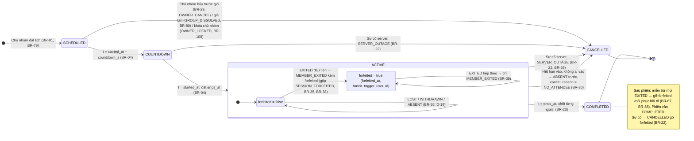

### 1.2 Cấp THÀNH VIÊN TRONG PHIÊN (03 §2.2, §3)

Chỉ áp cho **thành viên**; chủ nhóm không có trạng thái (D-25, BR-114). Trạng thái kết thúc là cuối cùng (BR-32); sự kiện mới bị bỏ qua (§3 #12).

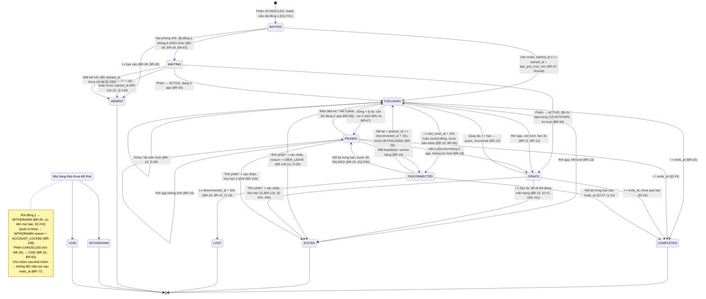

Ghi chú vẽ:
- "Mọi trạng thái chưa kết thúc" = INVITED, WAITING, FOCUSING, GRACE, PAUSED, DISCONNECTED; là nút gom để sơ đồ đọc được, không phải trạng thái thật.
- GRACE **không** vào DISCONNECTED (§3 #1, 05 §5). DISCONNECTED **không** bấm "Rời phiên" được (BR-118 (3), §3 #56).
- Chỉ mũi tên vào EXITED kích hoạt BR-35 (BR-36).
- Spike T-01 có thêm `lock_reclassified` (GRACE → FOCUSING khi tín hiệu khóa đến trễ) — **không** vẽ vì chưa có BR (DQ-F07).

### 1.3 NHÓM (03 §Máy trạng thái NHÓM)

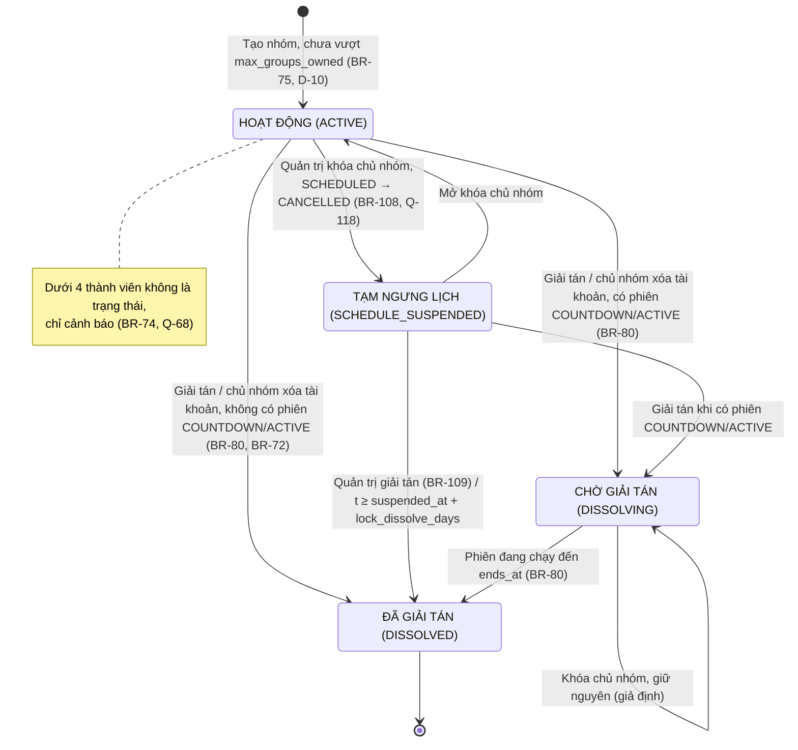

### 1.4 KHIẾU NẠI (03 §Máy trạng thái KHIẾU NẠI)

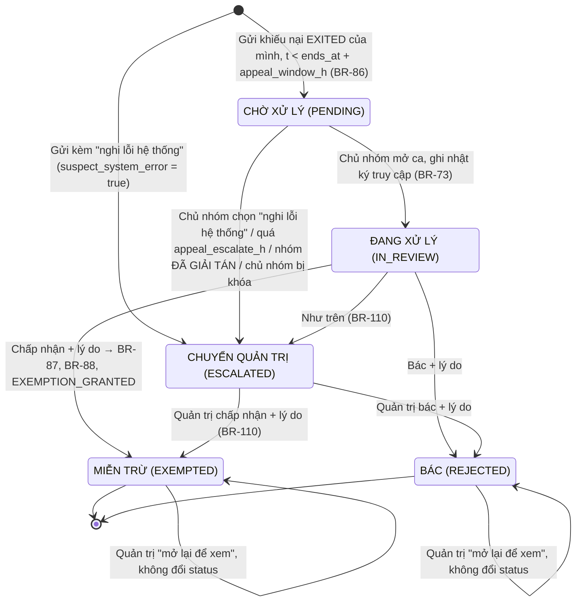

Giải trình (BR-85) **không** có máy trạng thái riêng: một giải trình/sự kiện EXITED, sửa được trong `explanation_edit_h`, sau đó chỉ xem.

---

## 2. Luồng then chốt (sequenceDiagram)

### 2.1 Đăng ký + vào nhóm + đồng ý

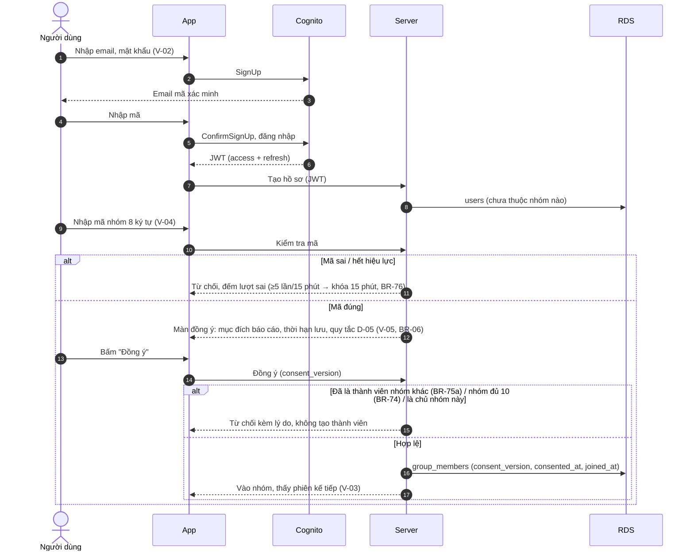

### 2.2 Chủ nhóm đặt lịch → mở phiên → đếm ngược

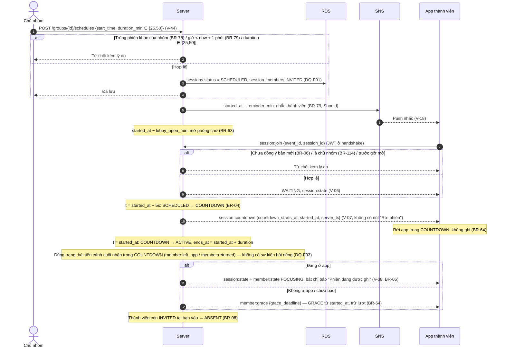

### 2.3 Rời app → khoan hồng 3s → quay lại

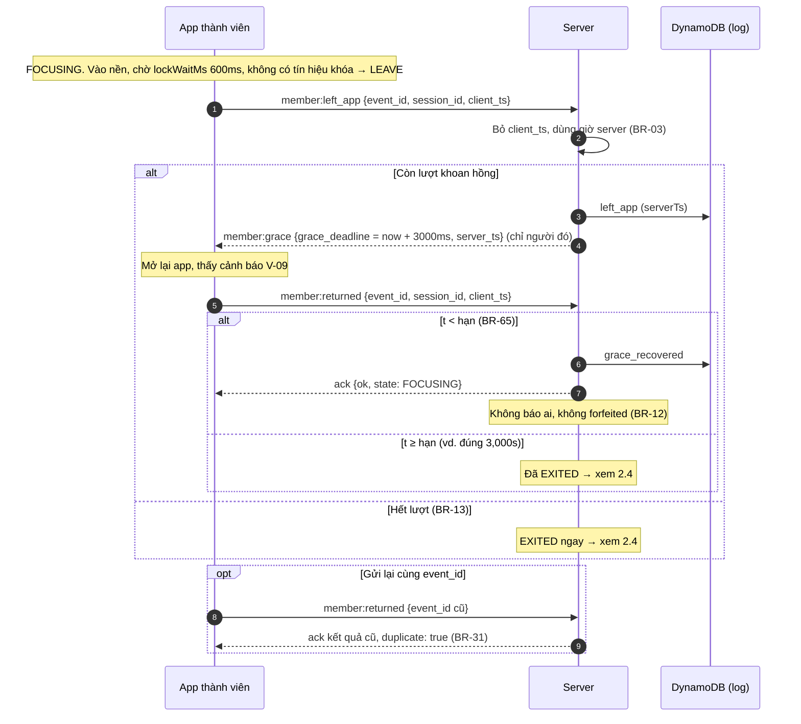

### 2.4 Rời app quá 3s → EXITED → MEMBER_EXITED (gộp SESSION_FORFEITED)

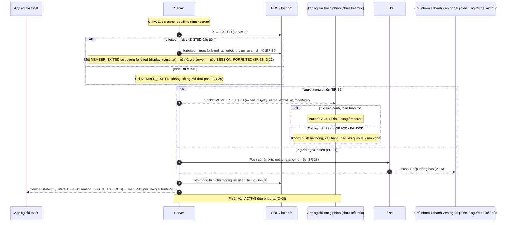

### 2.5 Khóa màn hình (không tính rời)

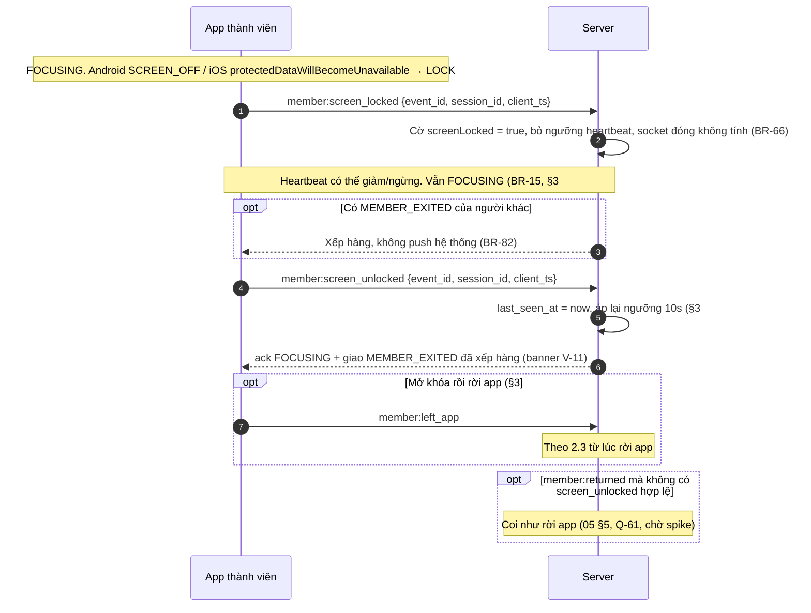

### 2.6 Bấm "Rời phiên" (D-29, BR-118)

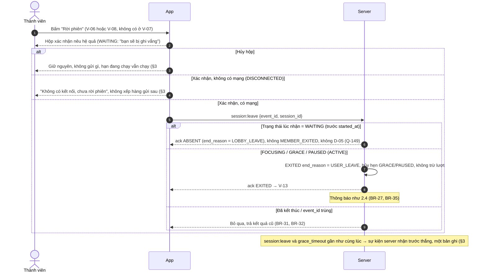

### 2.7 Mất mạng → DISCONNECTED → LOST

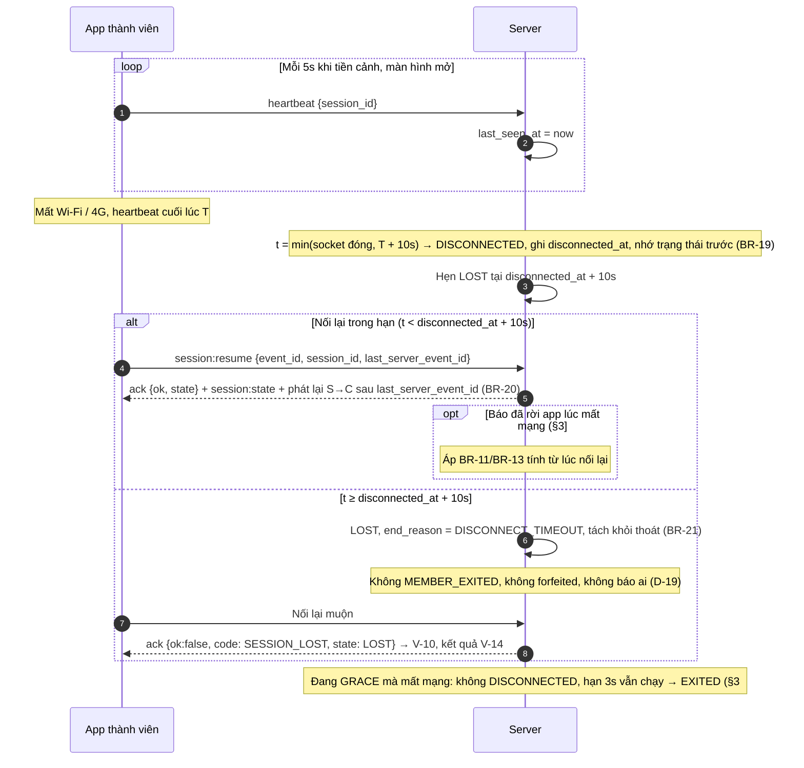

### 2.8 Sự cố server → hủy phiên

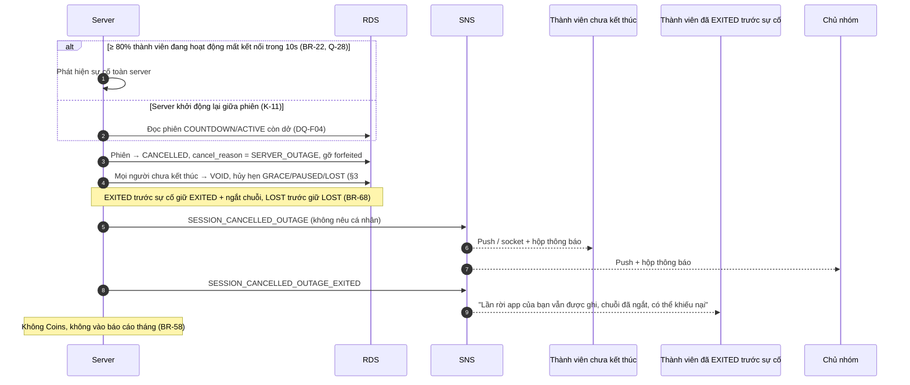

### 2.9 Kết thúc phiên → Coins sổ cái, điểm danh, chuỗi

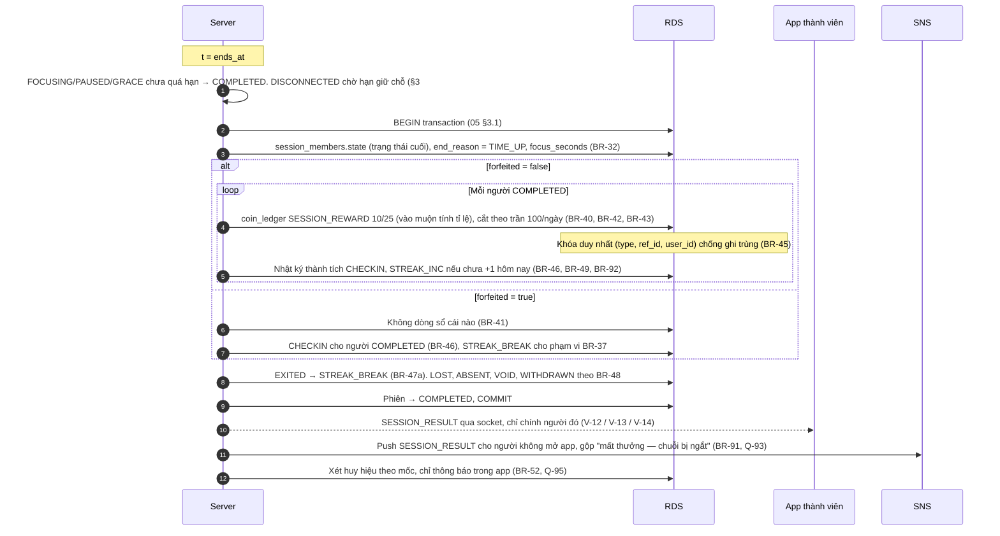

### 2.10 Giải trình + khiếu nại + miễn trừ

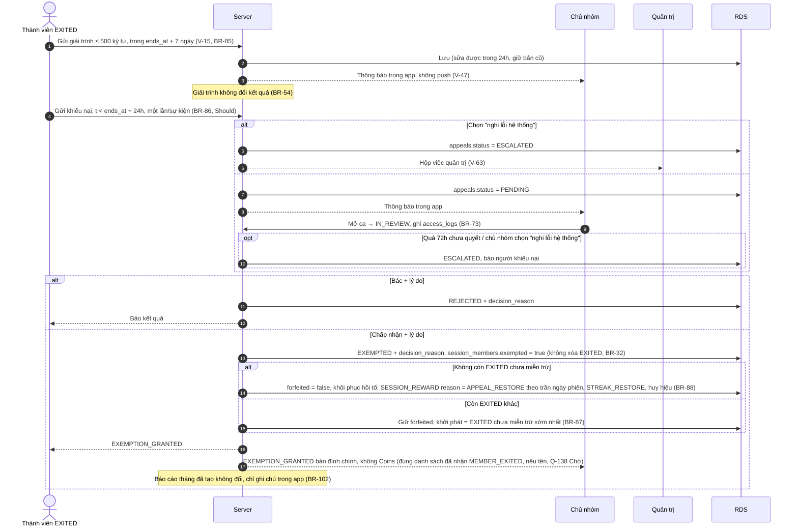

### 2.11 Báo cáo tháng (cron → bản chụp → email SES)

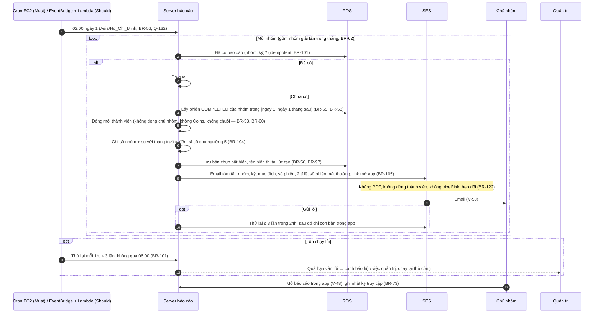

### 2.12 Chủ nhóm xem chi tiết phiên (kéo để làm mới, D-28)

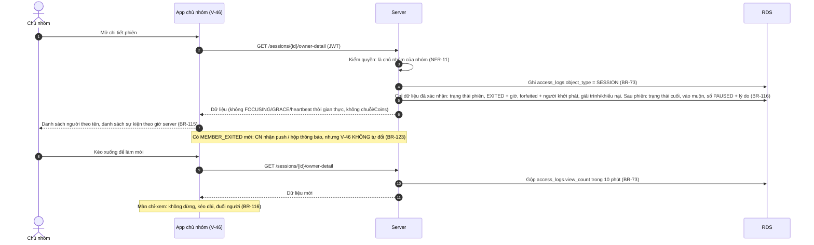

---

## 3. Bảng ánh xạ sơ đồ → BR, US, ca kiểm thử

K-xx theo `05` §6; S-xx là ca đo của spike T-01 (`spike/t01-lifecycle/README.md` §5). "—" = chưa có ca K tương ứng (DQ-F10).

| Sơ đồ | BR chính | US | Màn | K-xx / S-xx |
| --- | --- | --- | --- | --- |
| 1.1 Phiên | BR-01, BR-04, BR-22, BR-23, BR-29, BR-30, BR-35, BR-36, BR-39, BR-87 | US-02.10, US-02.11, US-03.02, US-03.08, US-03.10, US-03.12 | V-07, V-46 | K-01, K-02, K-09, K-11 |
| 1.2 Thành viên | BR-05…BR-09, BR-11…BR-21, BR-23, BR-26, BR-31, BR-32, BR-64…BR-66, BR-108, BR-118; §3 #1–#57 | US-03.01…US-03.07, US-03.10, US-03.11, US-01.07 | V-06…V-10, V-13, V-14 | K-02…K-08, K-10, K-16; S-01…S-15 |
| 1.3 Nhóm | BR-72, BR-74, BR-75, BR-80, BR-108, BR-109 | US-02.01, US-02.09, US-09.02, US-09.06 | V-41, V-42 | — |
| 1.4 Khiếu nại | BR-85, BR-86, BR-87, BR-110 | US-04.07, US-04.08, US-09.05 | V-63 | — |
| 2.1 Đăng ký + vào nhóm | BR-06, BR-71, BR-74, BR-75, BR-76 | US-01.01, US-01.05, US-02.03 | V-02, V-04, V-05 | K-14 |
| 2.2 Đặt lịch → đếm ngược | BR-02, BR-04, BR-05, BR-08, BR-63, BR-64, BR-78, BR-79, BR-114 | US-02.10, US-02.14, US-03.01, US-03.02, US-03.03 | V-44, V-18, V-06, V-07, V-08 | K-15 |
| 2.3 Khoan hồng 3s | BR-03, BR-11, BR-12, BR-13, BR-31, BR-65 | US-03.04, US-03.05 | V-08, V-09 | K-03, K-04, K-05, K-10; S-06, S-07, S-08 |
| 2.4 EXITED + thông báo | BR-14, BR-27, BR-28, BR-35, BR-38, BR-39, BR-81, BR-82 | US-03.08, US-03.09, US-04.01 | V-11, V-13, V-16 | K-02, K-09; S-01, S-02, S-05, S-18 |
| 2.5 Khóa màn hình | BR-15, BR-19, BR-66, BR-82, BR-34 | US-03.04 | V-08, V-11 | K-06, K-13; S-09…S-13, S-17 |
| 2.6 "Rời phiên" | BR-118, BR-31, BR-32, BR-33, BR-35; §3 #53–#57 | US-03.01, US-03.04 (AC-03.04.10) | V-06, V-08, V-13 | K-16 |
| 2.7 Mất mạng | BR-19, BR-20, BR-21, BR-65, BR-66; §3 #1, #2, #7, #41, #42 | US-03.07 | V-10, V-14 | K-07, K-08; S-14, S-15 |
| 2.8 Sự cố server | BR-22, BR-58, BR-68; §3 #8, #28, #44, #45, #52 | US-03.12, US-04.09 | V-16 | K-11 |
| 2.9 Kết thúc phiên | BR-23, BR-24, BR-37, BR-40…BR-49, BR-52, BR-91, BR-92 | US-03.10, US-05.01, US-05.03, US-05.05, US-06.01 | V-12, V-13, V-14, V-27 | K-01, K-02, K-09 |
| 2.10 Giải trình + khiếu nại | BR-54, BR-73, BR-85…BR-88, BR-102, BR-110 | US-04.05, US-04.06, US-04.07, US-04.08, US-09.05 | V-15, V-47, V-63 | — |
| 2.11 Báo cáo tháng | BR-53, BR-55…BR-62, BR-101, BR-104, BR-105, BR-122 | US-08.01, US-08.02, US-08.07, US-08.09 | V-48, V-50 | — |
| 2.12 Chi tiết phiên chủ nhóm | BR-73, BR-115, BR-116, BR-123 | US-08.10, US-04.06 | V-46 | K-14 |

---

## 4. Chỗ quy tắc chưa đủ để vẽ (DQ-F)

| Mã | Chỗ thiếu | Ảnh hưởng sơ đồ | Đề xuất (chưa chốt) |
| --- | --- | --- | --- |
| DQ-F01 | Không có BR nói **khi nào** tạo bản ghi INVITED (lúc đặt lịch, lúc COUNTDOWN hay lúc `started_at`) và ai được INVITED (thành viên tại lúc đặt lịch hay tại `started_at`). "Lượt dự kiến" (§Báo cáo §3) dùng "thành viên tại `started_at`". | 1.2 điểm vào, 2.2 bước lưu | (đề xuất) Tạo INVITED tại `started_at − lobby_open_min` cho thành viên đã đồng ý; chốt lại danh sách tại `started_at`. |
| DQ-F02 | Thành viên vào nhóm / đồng ý lại sau khi phiên đã SCHEDULED, hoặc chưa đồng ý lại (BR-71) — có INVITED không, hiện gì ở V-03? | 1.2, 2.1 | (đề xuất) Có INVITED nhưng vào bị chặn bởi BR-06; nếu chưa đồng ý lại thì đến hạn vào → ABSENT. |
| DQ-F03 | BR-64 "tại `started_at` server hỏi trạng thái tiền cảnh" — `05` §2 không có sự kiện S→C/C→S cho việc hỏi này, cũng không nói hết bao lâu thì coi là "chưa báo". | 2.2 bước hỏi tiền cảnh | (đề xuất) Server dùng trạng thái cuối nhận được trong COUNTDOWN (`left_app`/`returned`), không hỏi đồng bộ; thêm sự kiện vào `05` §2. |
| DQ-F04 | MVP 1 instance giữ trạng thái nóng trong bộ nhớ (05 §3.1). Khi server khởi động lại, ai/khi nào đặt CANCELLED và gửi `SESSION_CANCELLED_OUTAGE`? Danh sách người EXITED trước sự cố lấy từ đâu nếu chưa ghi xuống RDS? | 2.8 | (đề xuất) Ghi EXITED và `forfeited` xuống DB ngay khi xảy ra (không đợi `ends_at`); lúc khởi động quét phiên COUNTDOWN/ACTIVE còn dở → hủy. |
| DQ-F05 | DISCONNECTED từ PAUSED mà hạn tạm dừng hết trong lúc mất mạng (BR-20 "hạn tạm dừng vẫn chạy"): nối lại thì về PAUSED, FOCUSING hay GRACE? | 1.2 cạnh DISCONNECTED → PAUSED | (đề xuất) Áp BR-18 tại lúc nối lại: đang ở app → FOCUSING, không → GRACE không trừ lượt. |
| DQ-F06 | WAITING mất kết nối (Q-153): không có heartbeat bắt buộc ở WAITING (BR-05 không ghi sự kiện) nên server phát hiện bằng gì? Nối lại sau `started_at` nhưng trong hạn vào muộn thì ABSENT hay vào muộn? | 1.2 cạnh WAITING → ABSENT | (đề xuất) Chỉ dùng socket đóng; nếu US-03.11 đã làm thì xử lý như INVITED vào muộn. |
| DQ-F07 | Spike đề xuất `lock_reclassified` (tín hiệu khóa đến trong GRACE → FOCUSING, hoàn lượt) — chưa có BR, có rủi ro lách luật. | 1.2, 2.5 (không vẽ) | Chờ kết quả S-12; nếu cần thì tạo Q- và BR mới (README §7). |
| DQ-F08 | Tên sự kiện spike lệch `05` §2: spike dùng `member:join`, `session:end`, `clock:ping`; `05` dùng `session:join`, không có `session:end`. Spike phát `MEMBER_EXITED` cho **mọi** client, chưa phân kênh BR-82. | 2.2, 2.4 | Chuẩn hóa theo `05` §2 khi viết backend T-02; `clock:ping` thêm vào `05` §2 nếu giữ. |
| DQ-F09 | Hủy phiên SCHEDULED (BR-29, BR-80, BR-108) "thông báo thành viên" — không có mã sự kiện chuẩn (chỉ có `SESSION_CANCELLED_OUTAGE` cho sự cố). Kênh push hay chỉ hộp thông báo? | 1.1, 1.3 | (đề xuất) Thêm mã `SESSION_CANCELLED_BY_OWNER`, push + hộp thông báo cho thành viên. |
| DQ-F10 | `05` §6 chỉ có K-01…K-16, không có ca cho nhóm, khiếu nại, báo cáo tháng, đếm ngược/phòng chờ, tạm dừng (BR-16…BR-18), thông báo hủy sự cố khác bản EXITED. | Bảng mục 3 có "—" | (đề xuất) Bổ sung K-17+ cho PAUSED, BR-64, BR-30, máy trạng thái khiếu nại, BR-101 (idempotent báo cáo), BR-123. |
| DQ-F11 | `SESSION_RESULT` push (BR-91): gửi cho mọi người có trạng thái trong phiên hay chỉ người không mở app? Người ABSENT/VOID có nhận không? | 2.9 | (đề xuất) Socket cho người đang mở app; push cho người có trạng thái COMPLETED/EXITED/LOST không mở app; ABSENT không push. |
| DQ-F12 | Thứ tự trong transaction cuối phiên với DISCONNECTED chưa chốt tại `ends_at` (§3 #7): phải chờ tối đa 10s rồi mới chốt Coins cả phiên, hay chốt từng người? | 2.9 | (đề xuất) Chốt phiên tại `ends_at + disconnect_hold_s` khi còn DISCONNECTED; ghi rõ trong NFR-07. |
| DQ-F13 | Chi tiết phiên chủ nhóm (BR-116) khi phiên ACTIVE: số PAUSED kèm lý do có được thấy trước `ends_at` không (BR-116 liệt kê chung, §4 nói "chỉ thấy ở chi tiết phiên")? | 2.12 | (đề xuất) PAUSED/LOST/vào muộn chỉ hiện sau `ends_at`; trong phiên chỉ có trạng thái phiên + EXITED. |
